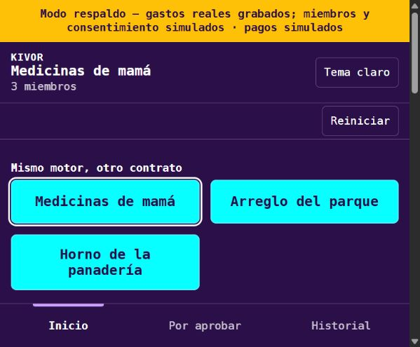
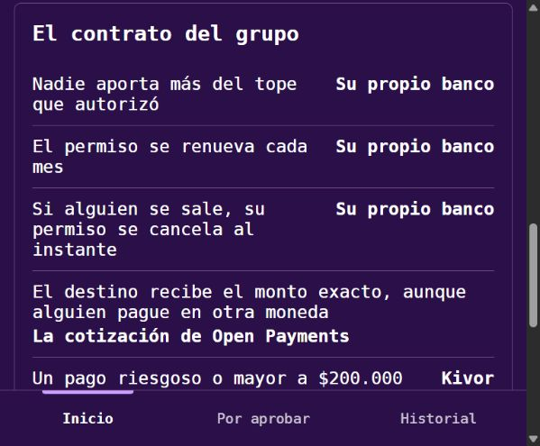
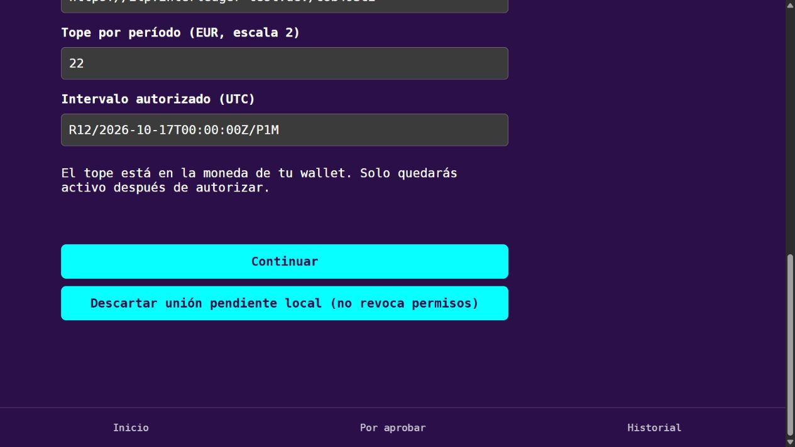

# R1 — preparación de Medicinas de mamá, cada mes

Revisión del 17 de octubre de 2026, antes de las 08:45 de Colombia.
Rama: r1-miembros. Base incorporada: origin/main, 5b1deb2, con PR #8 de R5.
No se cambiaron las reglas de riesgo, el contrato del grupo ni el lenguaje de R5.

## Metadatos consultados realmente con el SDK oficial

Consulta inicial: 08:10 de Colombia. Los nombres de direcciones pedidos no coinciden
con todas las direcciones disponibles para este usuario.

| Dirección pedida | Resultado público |
|---|---|
| hermano_1 | HTTP 404; sin metadatos verificables |
| hermano_2 | COP, escala 2 |
| hermano_3 | HTTP 404; sin metadatos verificables |
| farmacia-medellin | USD, escala 2; no se utiliza como destino COP |
| farmacia-medel1in | HTTP 404; falta dirección controlada para el ataque |

El usuario indicó que no tiene otras direcciones definitivas. Se verificaron las
anteriores y se preparó esta configuración local independiente:

| Persona de la historia | Dirección existente | Moneda | Escala | Tope solicitado |
|---|---|---|---|---|
| Hermano en Bogotá | https://ilp.interledger-test.dev/hermano_2 | COP | 2 | 100.000 COP = 10.000.000 unidades mínimas |
| Hermana en Medellín | https://ilp.interledger-test.dev/her | COP | 2 | 100.000 COP = 10.000.000 unidades mínimas |
| Hermano en Madrid | https://ilp.interledger-test.dev/c8b493c2 | EUR | 2 | 22 EUR = 2.200 unidades mínimas |
| Farmacia | https://ilp.interledger-test.dev/far | COP | 2 | No aplica |

La propiedad de las direcciones y sus fondos no se verifican mediante
walletAddress.get. Los dueños deben comprobarlos en su sesión de Test Wallet.
No se afirma que todas tengan fondos. La farmacia receptora no necesita fondos
para recibir, pero no se usa eso como prueba de su estado actual.

## Unión real: preparada, todavía no aprobada

API aislada: 3103. Web: http://localhost:5183/#/unirse.
Configuración local ignorada: .env.r1-live.json. No cambió .env ni la configuración
original. Se conserva el diario de intentos anteriores; no se borró ni se habilitaron
pagos para saltar su bloqueo.

Se comprobó el formulario real: selecciona las tres direcciones anteriores,
100000 para COP y 22 para EUR; intervalo R12/2026-10-17T00:00:00Z/P1M.
Son 12 períodos mensuales. No se configura un disparo automático del pago.

Cada dueño debe abrir la web en el mismo perfil donde inició sesión en su Test
Wallet, seleccionar su dirección y continuar. Antes de aceptar, verificar tope y
periodicidad y guardar la captura del consentimiento. Solo el dueño autoriza.
Después se debe comprobar el callback y el resultado real de Open Sentinels.

No se iniciaron ni aprobaron tres grants nuevos en esta revisión. No hay una
captura nueva del consentimiento bancario ni validación real nueva de sus hashes.
La disponibilidad de sesiones autenticadas del usuario en Chrome no está expuesta
al navegador conectado de esta tarea. No confundir la captura de fixtures con esa
prueba real pendiente.

## Comprobaciones completadas

- npm run demo:reset: correcto; genera demo/state.json con datos simulados.
  El archivo generado se retiró después de revisarlo, sin versionarlo.
- DEMO_MODE=fixtures: API aislada en 3102, web en http://localhost:5182.
- GET /api/mode: fixtures, con etiqueta explícita de simulación.
- POST /api/demo/reset contra 3102: correcto; tres grupos antes y después,
  Medicinas de mamá con tres miembros después del reset.
- Pruebas de miembros, reset y respaldo: 93 aprobadas, seis archivos.
- Regresiones de motor, mock y panel del contrato de R5: 77 aprobadas, tres archivos.
- npm run typecheck: correcto.
- No se enviaron pagos ni se modificaron permisos bancarios.

## Capturas: exclusivamente respaldo

## Pendiente humano y coordinación

1. Confirmar fondos en las tres cuentas pagadoras desde sus sesiones.
2. Completar los tres consentimientos y conservar sus capturas antes de aceptar.
3. Comprobar los tres callbacks reales y hashes de Open Sentinels.
4. Acordar con R5/R3 una dirección controlada para el destino parecido; no sustituir
   silenciosamente la farmacia COP por una dirección USD.
5. R3 debe considerar el bloqueo histórico por los intentos no conciliados. El nuevo
   entorno permite preparar uniones; no demuestra que la demo de pagos esté lista.
6. Después de la corrida de las 09:15: actualizar README principal y la fila R1 de
   AI_USAGE.md según el plan aprobado. No se adelantó esa edición.

Fuentes: https://openpayments.dev/es/guides/outgoing-grant-future-payments/
y https://openpayments.dev/sdk/wallet-address-get/.
El snippet ../open-payments-snippets/grant/grant-outgoing-payment-interval.ts no
está en la ruta local indicada; se consultó la guía oficial y se reutilizó el
flujo existente del repositorio. Nunca se registran llaves ni tokens.

## Formulario real preparado (no es consentimiento bancario)

## Nueva comprobación del destino indicado por R5

Se volvió a consultar farmacia-medellin: USD, escala 2. farmacia-medel1in devuelve
HTTP 404. far sigue en COP, escala 2. No se modificó pharmacy en los dos archivos
locales porque loadLiveConfig exige destino COP y rechazaría el destino USD.

Se reprodujo con checkDestination real, sin red de pagos:
- Destino conocido far frente a farmacia-medel1in: warn, 20 puntos.
- Destino conocido farmacia-medellin frente a farmacia-medel1in: warn, 94 puntos.

La comparación de nombres es correcta, pero no confirma la moneda ni la propiedad
de la dirección receptora. Falta confirmar con su dueño una dirección COP adecuada
y la dirección parecida controlada. No se crearon cuentas ni direcciones externas.
